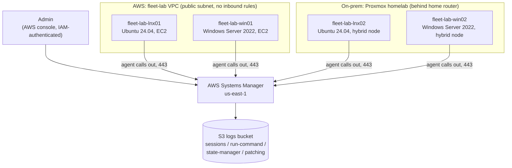

# Hybrid Fleet Management with AWS Systems Manager

I built a centralized management console for a hybrid fleet: two servers in AWS and two on-prem servers in my homelab, all managed from one AWS console with **no inbound ports open on any of them**.

## Why I built this

I wanted more hands-on experience with AWS and a better understanding of what it can do. I chose VM management because it's a real production problem that companies deal with every day: how do you securely access, configure, and patch servers when some live in the cloud and some live in your own building?

## The scenario

Lakeview Title & Escrow (a fictional 30-person firm) runs two servers in an office closet and two in AWS. Their one IT admin manages all of them by hand: RDP and SSH with a shared admin password, patching "when there's time," and no record of who touched what.

Their cyber insurance renewal added these requirements:

| Requirement | How this project meets it |
|---|---|
| No RDP or SSH exposed to the internet | The security group has zero inbound rules. Shell and RDP access run through Session Manager over the agent's outbound connection. |
| Critical patches applied within 14 days, with evidence | Patch baselines approve security patches 7 days after release, and a weekly maintenance window installs them. Compliance reports and S3 output are the evidence. |
| Inventory of every server | Not built in this project. See "Out of scope." |

## Results

- 4 servers managed from one console: 2 EC2 instances and 2 on-prem Proxmox VMs, running Ubuntu and Windows Server
- Zero inbound firewall rules, and no port forwarding on my home router
- Initial patch scan: 1 of 4 servers compliant, 14 missing patches across the other three
- After one scheduled maintenance window: **4 of 4 compliant**, with no one logged in to any server
- Configuration drift fixed automatically: I disabled NTP on Linux and the Windows firewall by hand, and Systems Manager turned both back on
- The whole AWS side rebuilt in Terraform

## What surprised me

Systems Manager is outbound only. The agent on each server calls out to AWS and asks for work, so nothing ever connects in and no ports need to be open on the VMs. I didn't know a technology like that existed. It changed how I think about remote access: you can manage a server sitting behind a home router the same way you manage one in AWS.

## The hardest part

Getting the agent installed on the on-prem VMs, mainly the Linux one, since I'm still learning to troubleshoot Linux. The agent installed fine, but my status checks kept saying the service didn't exist. It turned out Ubuntu installed it as a snap package, which runs under a different service name. I used AI to help me work through the troubleshooting. The Windows VM had its own issue: the agent installed but never registered, and re-entering the activation code by hand fixed it.

## How this applies to real work

At my current job, every server we run is on-prem. Projects like this show that Systems Manager doesn't require cloud servers at all: hybrid activations let it manage on-prem machines, which is exactly what my Proxmox VMs were. For a company with a mix of cloud and on-prem servers, the benefit is even bigger: one console, one patching process, and one audit trail for everything.

**What I can do now:** design and build a centralized management solution for hybrid systems, covering secure remote access, automated configuration, and scheduled patching with compliance reporting.

---

## Architecture



## What's built

| Area | Resources |
|---|---|
| Network | VPC, one public subnet, internet gateway, S3 gateway endpoint (free), security group with outbound rules only |
| Identity | EC2 instance role and hybrid node role, both with `AmazonSSMManagedInstanceCore` plus a scoped S3 write policy. The hybrid role's trust policy is locked to my account with `aws:SourceAccount` and `aws:SourceArn` (confused-deputy protection). |
| Compute | Launch templates for Ubuntu and Windows: IMDSv2 required, encrypted gp3 volumes, AMI pulled from public SSM parameters at launch so every launch gets the latest image |
| Remote access | Session Manager with session transcripts logged to S3 and a 15-minute idle timeout. Fleet Manager browser RDP for Windows. |
| Configuration | State Manager associations, targeted by tag, that enforce NTP on Linux and the firewall on Windows. Scripts are idempotent and report `COMPLIANT` or `DRIFT CORRECTED`. |
| Patching | Custom Windows and Ubuntu baselines set as the account defaults, a daily scan to keep compliance current, and a weekly maintenance window (Sunday 2 AM Central) that installs and reboots two servers at a time |
| Cost | $5 monthly budget alert |

The AWS side is all Terraform. The on-prem VMs were onboarded by hand with a hybrid activation, which is how on-prem servers are usually onboarded in real environments.

## Design decisions

**Why approve patches after 7 days instead of right away?** A short delay lets the rest of the world find a bad patch first. 7 days of approval delay plus a weekly window means any patch is installed within 14 days of release, which meets the insurance requirement.

**Why target everything by tag?** Commands, configuration rules, and the patch window all target tags like `OS=Linux` or `Environment=Lab`, never specific servers. A new server only needs the agent and the right tags, and nothing else changes.

**Why terminate the EC2 instances between sessions?** They're disposable. The launch template rebuilds them in one click, and State Manager reapplies the configuration on its own.

**Why a public subnet?** Cost. A production build would put the servers in private subnets with interface VPC endpoints for `ssm`, `ssmmessages`, and `ec2messages`. Each endpoint bills hourly, so I skipped them for the lab.

## Lessons learned

- **A security group gives permission; a route table gives a path.** An outbound "allow all" rule does nothing without a route to the internet.
- **Session Manager access is root access.** The `ssm-user` account has passwordless sudo on Linux and local admin on Windows, so anyone allowed to start a session on a server effectively owns it. Access control moves from server passwords to IAM.
- **A leaked hybrid activation code registers someone else's machines into your account.** The defenses are an instance limit, a short expiry, and deleting the activation as soon as your servers register.
- **Activation tags didn't carry over to the registered servers.** Tag hybrid servers after they register.
- **On Ubuntu, the hybrid agent installs as a snap.** The service is `snap.amazon-ssm-agent.amazon-ssm-agent`, not `amazon-ssm-agent`.
- **Tag mismatches fail silently.** One server tagged `OS=Windows Server` instead of `OS=Windows` was skipped with no error.
- **Compliance only counts approved patches, and it's only as current as the last scan.** That's why a daily scan runs alongside the weekly install window.
- **Maintenance windows run under their own identity.** The service-linked role `AWSServiceRoleForAmazonSSM` doesn't show up in the console's role picker, and leaving the field blank uses it.
- **Terraform can adopt resources that already exist.** I used `import` blocks to take over the hybrid role and Session Manager settings without recreating them, so the on-prem servers never lost their connection.

## Production hardening (not built here)

- Private subnets with SSM interface endpoints
- S3 Object Lock or a separate log-archive account, so no one, including admins, can alter session logs
- IAM policies that limit who can start sessions on which servers
- A test group that gets patches a few days before production, a health check after patching, and snapshots before patching

## Out of scope

- **Inventory** (`AWS-GatherSoftwareInventory`) was left out of this build, so the insurance inventory requirement isn't demonstrated here.

## Deploy

Requires Terraform 1.5 or later, AWS credentials for `us-east-1`, and an existing EC2 key pair named `fleet-lab-win-key`.

```
cp terraform.tfvars.example terraform.tfvars   # add your email
terraform init
terraform plan
terraform apply
```

`imports.tf` adopts a hybrid role and Session Manager settings that already existed in my account. On a fresh account, delete `imports.tf` before applying.

The weekly patch window deploys **disabled**. Set `patch_window_enabled = true` to turn it on.

## Cost

About $2 to $3 for the whole project. I terminated the EC2 instances after every session and skipped the NAT gateway, interface endpoints, and KMS keys.

## Teardown

1. Deregister the hybrid servers in Fleet Manager and uninstall the agent from the VMs.
2. Terminate any running instances launched from the templates.
3. `terraform destroy`
4. Delete the `fleet-lab-win-key` key pair.